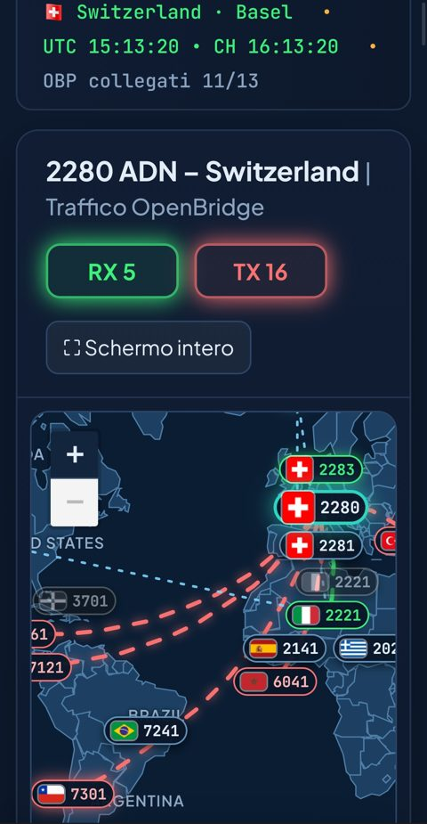
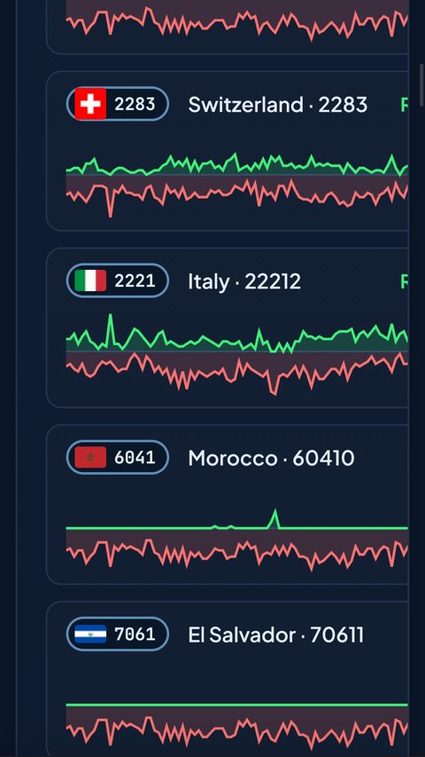
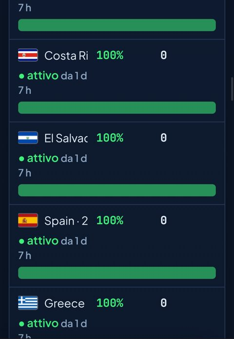
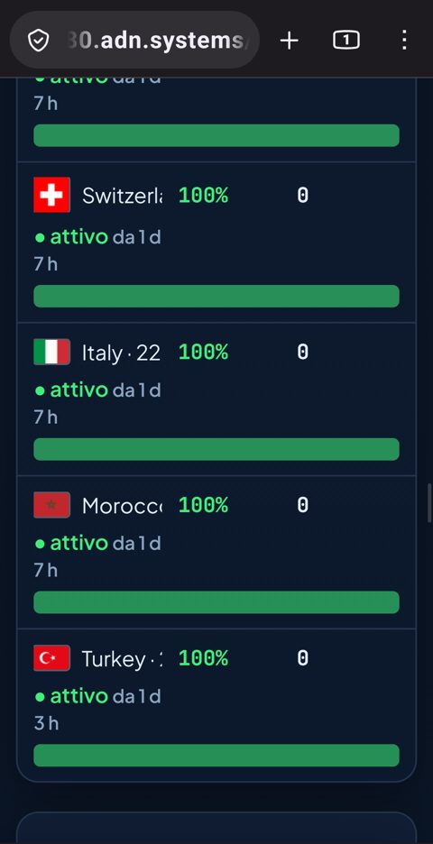
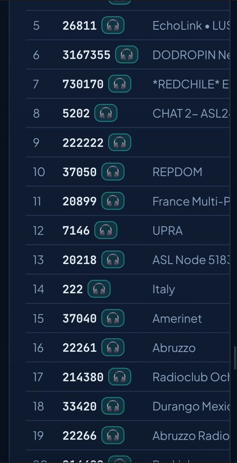
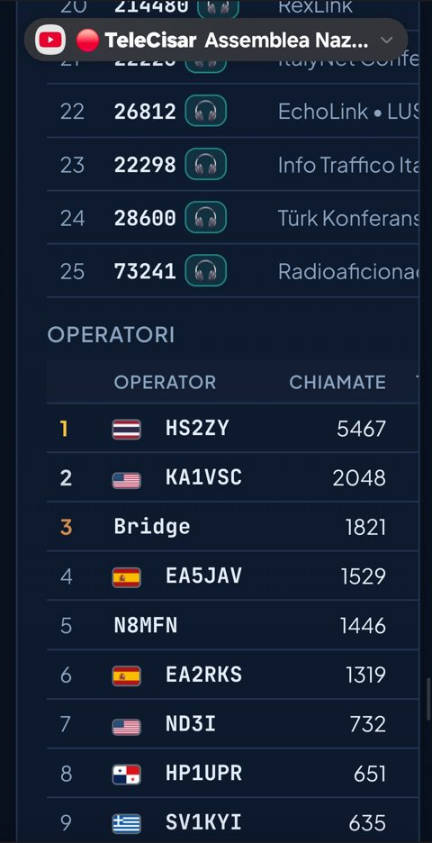

# adn-obpmap

**Mappa OpenBridge in tempo reale, statistiche e pagina ADN Live per i server DMR ADN Systems**

[🇬🇧 English](README.md) · 🇮🇹 Italiano

`adn-obpmap` aggiunge a un server **ADN Systems** (ADN Server v2 + ADN Monitor) una pagina all'indirizzo `https://<tua-dashboard>/obpmap/`. Mostra dove si trovano i tuoi partner OpenBridge (OBP), quale traffico entra ed esce, quanto è affidabile ogni collegamento e quali talkgroup e operatori sono i più attivi.

Funziona **accanto** ad ADN Monitor e **non lo modifica**. La pagina legge gli stessi dati in tempo reale della dashboard, dal websocket `/ws` del Monitor. Un piccolo registratore in Python puro, senza librerie aggiuntive, salva lo storico.

Scritto da zero da **Gabriele Biscetti, HB9TVW** per ADN 2280 (Svizzera). L'esempio funzionante è su <https://2280.adn.systems/obpmap/>.

---

## Indice

1. [Cosa si vede nella pagina](#1-cosa-si-vede-nella-pagina)
2. [Come funziona](#2-come-funziona)
3. [Requisiti](#3-requisiti)
4. [Installazione](#4-installazione)
5. [Configurazione (`config.js`)](#5-configurazione-configjs)
6. [Come attivare ogni funzione](#6-come-attivare-ogni-funzione)
7. [Aggiornamento e disinstallazione](#7-aggiornamento-e-disinstallazione)
8. [Problemi frequenti](#8-problemi-frequenti)
9. [File](#9-file)
10. [Ringraziamenti e licenza](#10-ringraziamenti-e-licenza)

---

## 1. Cosa si vede nella pagina

*Screenshot dal server ADN 2280 (telefono).*

| Mappa in tempo reale | Attività OpenBridge | Flussi OpenBridge |
|:-:|:-:|:-:|
|  |  |  |

| Stato dei link | Scheda rete | Talkgroup più attivi |
|:-:|:-:|:-:|
|  |  |  |


### 1.1 La mappa in tempo reale

| Elemento | Significato |
|---|---|
| **Etichetta turchese con alone** | **Il tuo server** (il centro), con bandiera e numero del server. |
| **Etichette sopra / sotto il centro** | Gli altri tuoi server nello stesso luogo (opzione `stacked`), impilati per non coprirsi. |
| **Etichetta con bandiera e numero** | Un **partner OBP**. Il numero è il numero di server ADN del partner (le prime 4 cifre del suo `NETWORK_ID` OpenBridge, es. `20220` → `2022`). |
| **Etichetta verde lampeggiante + linea tratteggiata verde** | **RX**: quel partner ti sta inviando una chiamata in questo momento. |
| **Etichetta rossa lampeggiante + linea tratteggiata rossa** | **TX**: stai inviando una chiamata a quel partner in questo momento. |
| **Etichetta grigia** | Il collegamento OBP è **offline** (non collegato). |
| **Riquadro accanto a un'etichetta** (bordo arancione) | Le chiamate in corso su quel collegamento: direzione (RX/TX), nominativo, talkgroup e secondi in aria. I riquadri si dispongono da soli per non uscire dai bordi e non coprire gli altri riquadri o le etichette. |
| **Puntini azzurri** (bandiera in un anello azzurro) | Il **paese dell'operatore**. Le prime tre cifre di un DMR ID sono il codice del paese (MCC); per esempio `2284017` → `228` = Svizzera. Per ogni chiamata in corso compare un puntino azzurro sul paese dell'operatore, con una **linea azzurra punteggiata** verso l'OBP da cui è entrata la chiamata, oppure verso il tuo server per i tuoi utenti locali. **Tocca o passa sopra un puntino** per vedere quali operatori parlano da quel paese. Così si scopre, per esempio, che una chiamata arrivata dalla Grecia viene in realtà da un operatore in Belgio. |
| **⛶ Schermo intero** | Mappa a schermo intero; la mappa si riadatta alla nuova dimensione. |

Sul telefono la mappa si apre centrata sull'Atlantico, così Europa e Americhe si vedono insieme.

### 1.2 Attività OpenBridge

Un grafico del traffico per ogni OBP e per tutta la rete: **ricevuto (RX) sopra la linea, inviato (TX) sotto**.
- Scegli **Streams** (numero di chiamate) o **Tempo di parlato**.
- Scegli il periodo: **15 min, 1 h, 3 h, 6 h, 12 h o 24 h**.

### 1.3 Flussi OpenBridge

Un diagramma di flusso. **A sinistra:** da dove arriva ogni chiamata (un OBP, oppure gli "utenti locali" del tuo server). **A destra:** gli OBP verso cui il tuo server l'ha inoltrata. Più è spessa la banda, più traffico c'è. Passa sopra una banda per evidenziarla.

### 1.4 Stato dei link

Per ogni OBP: lo stato attuale (**collegato da** / **SCOLLEGATO da**), la **disponibilità** su **24 h / 7 giorni / 30 giorni**, il numero di **interruzioni** e una **linea del tempo**.
- Il **rosso** indica un'interruzione. Il **grigio** è il periodo prima dell'inizio del monitoraggio.
- Un collegamento conta come caduto solo dopo **2 minuti** senza connessione, così le brevi cadute non vengono contate.

### 1.5 Scheda rete *(facoltativa)*

Se gestisci più server ADN, le loro schede compaiono affiancate. Ogni scheda mostra:
- se il suo registratore è attivo;
- quanti OBP sono collegati;
- chiamate e tempo di parlato nell'ultima ora, chiamate e operatori in 24 h;
- un'etichetta per ogni OBP (rossa = scollegato);
- i suoi 5 talkgroup più usati;
- il link alla sua dashboard.

### 1.6 Talkgroup e operatori più attivi

Classifiche per **1 h, 24 h o 7 giorni**, per **numero di chiamate** o **tempo di parlato**:
- **talkgroup**, con il loro nome;
- **operatori**, con nome, bandiera, link a QRZ e ultimo talkgroup usato ("via OBP-xxx" oppure "locale").

I nomi vengono dal Last Heard del Monitor.

### 1.7 Tabella OpenBridge e scheda di dettaglio

La tabella elenca tutti gli OBP: paese, nome, `NETWORK_ID`, stato e chiamate in corso.

**Tocca una riga, oppure un'etichetta sulla mappa,** per aprire la scheda di dettaglio:
- lo stato in tempo reale e le chiamate in aria;
- la disponibilità su 24 h e 7 giorni, le interruzioni nelle 24 h;
- un grafico dell'attività RX/TX delle ultime 24 ore;
- i talkgroup più usati;
- le ultime chiamate, con link a QRZ.

Sul telefono la scheda sale dal basso.

### 1.8 Pulsanti 🎧 e pagina ADN Live

Accanto ai talkgroup c'è un pulsante **🎧**. Apre **`/obpmap/live/?tg=…`** e **ADN Live** (`listen.adn.systems/?tg=…`) parte direttamente su quel talkgroup.

`/obpmap/live/` è una pagina con la **tua** barra in alto (logo, Dashboard, Mappa OpenBridge, selettore lingua) e ADN Live incorporato sotto. **↗ App** apre ADN Live originale, dove si può installare la sua app ufficiale.

### 1.9 App installabile

Chrome ed Edge propongono **"Installa ADN Systems <tuo numero>"** (menu ⋮ → *Installa app*). L'app si apre a schermo intero sulla pagina ADN Live, con Dashboard e Mappa nella barra.

### 1.10 17 lingue

Il selettore in alto ha le stesse 17 lingue di ADN Monitor: EN, ES, PT, FR, DE, IT, NL, CA, BG, ZH, ET, EL, PL, SR, TH, TR e UK. La scelta è salvata nello **stesso cookie `language` del Monitor**, quindi se cambi lingua nella dashboard cambia anche nella mappa, e viceversa.

### 1.11 Avvisi Telegram *(facoltativi)*

Il registratore può inviare un messaggio Telegram quando un OBP **resta scollegato per più di 2 minuti**, e quando **torna collegato**, indicando quanto è rimasto giù. I messaggi sono in inglese o in italiano.

---

## 2. Come funziona

```
 ADN Server ──report──► ADN Monitor ──websocket /ws──┬──► browser: /obpmap/ (mappa, riquadri live, tabella)
                                                     │
                                                     └──► obp-recorder (python3, utente obprec)
                                                            │ scrive ogni 30 s / 1 min
                                                            ▼
                                     /opt/obpmap/data/history.json  (24 h, attività + flussi)
                                     /opt/obpmap/data/stats.json    (7 giorni, talkgroup / operatori)
                                     /opt/obpmap/data/tops.json     (piccolo: classifiche, stato dei link)
                                                            │
                                     il browser li legge ◄──┘   (+ avvisi Telegram facoltativi)

 netfetch.sh (cron, ogni minuto) ──► copia il tops.json dei tuoi ALTRI server in data/net/ (scheda rete)
```

- La pagina si collega a `wss://<tua-dashboard>/ws`, lo stesso proxy websocket della dashboard. **Per questo la mappa deve essere servita dallo stesso sito Apache della dashboard.**
- Senza il registratore la mappa in tempo reale funziona lo stesso, ma Attività, Flussi, Stato dei link, classifiche e scheda di dettaglio restano vuoti.
- Il browser carica Leaflet, topojson, i confini del mondo e le bandiere da CDN pubblici (cdnjs, jsDelivr, flagcdn). Nessun dato dei tuoi utenti viene inviato altrove.

---

## 3. Requisiti

- Un server **ADN Systems** con **ADN Server v2** e **ADN Monitor** (provato con **2.6.1 e 2.7.0**).
- **Apache 2** che serve la dashboard del Monitor, con `ProxyPass /ws ws://127.0.0.1:<porta>/ws` (configurazione standard del Monitor).
- **python3** (solo libreria standard) e **curl** (solo per la scheda rete).
- *Facoltativi:* `python3-pil` e `fonts-dejavu-core`, per creare le icone dell'app.
- Accesso root.

---

## 4. Installazione

```bash
cd /opt
git clone https://github.com/hb9tvw/adn-obpmap.git adn-obpmap-src
cd adn-obpmap-src
sudo apt install -y python3-pil fonts-dejavu-core   # facoltativo: icone dell'app
sudo ./install.sh
```

*(Se lavori come root e `sudo` non è installato, togli semplicemente `sudo` da tutti i comandi.)*

L'installatore fa quattro domande: il **numero del server**, il **nome** per titoli e avvisi, la **porta del Monitor** (propone quella a cui il tuo Apache inoltra `/ws`) e la **lingua degli avvisi** (en/it). Poi:
- crea l'utente di sistema **`obprec`**;
- copia la pagina in **`/opt/obpmap`**;
- crea `config.js` e le icone dell'app;
- installa e avvia il servizio **`obp-recorder`** e il cron di `netfetch`.

**Poi tre passi a mano.**

**1. Apache.** Aggiungi le righe di [`system/apache-obpmap.conf`](system/apache-obpmap.conf) **dentro il `<VirtualHost>` della tua dashboard** (quello HTTPS, se usi Let's Encrypt). Poi:
```bash
sudo apache2ctl configtest && sudo systemctl reload apache2
```

**2. Configurazione.** Modifica `/opt/obpmap/config.js`: paese, città, coordinate, fuso orario e così via (vedi la sezione seguente).

**3. Apri** `https://<tua-dashboard>/obpmap/`.

---

## 5. Configurazione (`config.js`)

`/opt/obpmap/config.js` contiene tutto ciò che riguarda il **tuo** server. Gli aggiornamenti non lo sovrascrivono mai. Le modifiche si vedono ricaricando la pagina, senza riavviare niente.

| Chiave | Esempio | Significato |
|---|---|---|
| `serverId` | `'2280'` | Numero sull'etichetta centrale e nei titoli. |
| `serverName` | `'ADN 2280'` | Nome nei riquadri e nei flussi. |
| `homeNetworkId` | `'22810'` | Facoltativo: il `NETWORK_ID` OBP con cui ti conoscono i partner (riquadro del centro). |
| `country`, `cc`, `city` | `'Switzerland'`, `'ch'`, `'Basel'` | Intestazione e centro. `cc` è il codice ISO di due lettere usato per la bandiera. |
| `lat`, `lon` | `47.56, 7.59` | Dove viene disegnata l'etichetta centrale. |
| `timeZone`, `tzLabel`, `locale` | `'Europe/Zurich'`, `'CH'`, `'de-CH'` | Fuso orario e formato di tutti gli orari della pagina. |
| `stacked` | `['2283','22812']` | `NETWORK_ID` degli OBP verso altri tuoi server nello stesso luogo, disegnati sopra e sotto il centro. |
| `locations` | `{'22210': ['it',41.9,12.5,'Italy','left']}` | Posizione di partner OBP che la mappa non conosce, oppure correzioni: codice, latitudine, longitudine, nome del paese, lato preferito del riquadro. Gli ID sconosciuti vengono messi nel loro paese, ricavato dalle prime 3 cifre. |
| `networkTitle`, `network` | vedi l'esempio | La scheda rete (sezione 6.3). Lista vuota = scheda nascosta. |
| `adnLiveUrl` | `'https://listen.adn.systems/'` | Pagina incorporata da `/obpmap/live/`. |
| `footer` | `'ADN Systems 2280 · …'` | Testo del piè di pagina. |

---

## 6. Come attivare ogni funzione

### 6.1 Mappa in tempo reale, tabella e scheda di dettaglio
Funzionano appena Apache serve `/obpmap` sul sito della dashboard. Non serve altro.

### 6.2 Storico, classifiche e stato dei link (`obp-recorder`)
L'installatore ha già avviato il registratore. Per controllarlo:
```bash
systemctl status obp-recorder
journalctl -u obp-recorder -n 20     # deve dire: connected to ADN Monitor websocket
ls -l /opt/obpmap/data/              # history.json, stats.json, tops.json aggiornati ogni minuto
```
Le impostazioni sono in `/etc/systemd/system/obp-recorder.service`:
- `OBP_SERVER_NAME`: nome negli avvisi;
- `OBP_WS_PORT`: porta di ADN Monitor;
- `OBP_ALERT_LANG`: `en` o `it`;
- `OBPMAP_DIR`: cartella di installazione.

Dopo una modifica: `systemctl daemon-reload && systemctl restart obp-recorder`.

Il registratore si ricollega da solo quando ADN Monitor si riavvia.

### 6.3 Scheda rete con i tuoi altri server
Su **ognuno degli altri server**:
1. Installa adn-obpmap. Lì basta il registratore, ma l'installatore completo non fa danni.
2. Pubblica il suo `tops.json`, aggiungendo al suo sito Apache le righe facoltative `Alias /obpdata/tops.json …` di `system/apache-obpmap.conf`.

Sul **server che mostra la scheda**:
1. In `/opt/obpmap/netfetch.list` aggiungi una riga per server: `<id> <url del suo tops.json>`. Per esempio:
   ```
   2283 https://2283.adn.systems/obpdata/tops.json
   ```
2. In `config.js` compila `network`: una voce per server, compreso questo con `url: 'data/tops.json'`, e gli altri con `url: 'data/net/<id>.json'`.

Il cron `/etc/cron.d/obpmap-netfetch` copia i file ogni minuto.

### 6.4 Avvisi Telegram
1. Crea un bot con **@BotFather** e copia il suo **token**.
2. Scrivi un messaggio al bot (o aggiungilo a un gruppo), poi apri `https://api.telegram.org/bot<token>/getUpdates` per trovare il **chat_id**.
3. Crea il file di configurazione:
   ```bash
   sudo mkdir -p /etc/obpmap
   echo '{"token": "123456:ABC...", "chat_id": "-100123456789"}' | sudo tee /etc/obpmap/telegram.json
   sudo chown root:obprec /etc/obpmap/telegram.json && sudo chmod 640 /etc/obpmap/telegram.json
   sudo systemctl restart obp-recorder
   ```

Se il file non c'è, non viene inviato nessun avviso.

### 6.5 Pagina ADN Live e pulsanti 🎧
Funzionano subito su `/obpmap/live/`. Per cambiare la pagina incorporata, imposta `adnLiveUrl` in `config.js`.

### 6.6 App installabile
L'installatore crea `manifest.webmanifest` e le icone `icon-192.png` / `icon-512.png`, dal logo della dashboard più il numero del tuo server.

Se mancano le icone:
```bash
sudo apt install python3-pil fonts-dejavu-core
sudo rm -f /opt/obpmap/icon-*.png && sudo ./install.sh --update
```
Poi Chrome propone *Installa app*. Serve HTTPS.

### 6.7 Lingue
Non serve fare niente: il selettore compare da solo nella barra in alto. Per aggiungere o correggere una traduzione, modifica il dizionario in `web/i18n.js`. `{SRV}` sta per il numero del tuo server.

### 6.8 Voci nel menu della dashboard ADN Monitor
In `adn-monitor.yaml` aggiungi le voci a `nav_links`, poi riavvia il Monitor:
```yaml
  nav_links:
    name: "Links"
    items:
      - name: "OBP Map"
        url: "/obpmap/"
      - name: "ADN Live"
        url: "/obpmap/live/"
```
```bash
sudo systemctl restart adn-monitor
```

---

## 7. Aggiornamento e disinstallazione

**Aggiornare.** Restano invariati `config.js`, `netfetch.list`, i dati e le impostazioni del servizio:
```bash
cd /opt/adn-obpmap-src && git pull && sudo ./install.sh --update
```

**Disinstallare:**
```bash
sudo systemctl disable --now obp-recorder
sudo rm -f /etc/systemd/system/obp-recorder.service /etc/cron.d/obpmap-netfetch
sudo rm -rf /opt/obpmap /etc/obpmap
sudo userdel obprec
```
Poi togli le righe `/obpmap` dal sito Apache e ricarica Apache.

---

## 8. Problemi frequenti

| Sintomo | Cosa controllare |
|---|---|
| "riconnessione…" e mappa vuota | `/ws` deve arrivare ad ADN Monitor. La mappa deve stare sullo **stesso sito Apache** della dashboard, e la dashboard stessa deve mostrare dati live. |
| Mappa ok, ma Attività, Flussi, Stato e classifiche restano "caricamento" | `journalctl -u obp-recorder`: verifica che la porta sia giusta (`OBP_WS_PORT`) e che `/opt/obpmap/data/*.json` si aggiorni ogni minuto e sia leggibile da Apache. |
| Un OBP non ha l'etichetta | Il suo `NETWORK_ID` non è conosciuto: aggiungilo in `locations` in `config.js`. |
| Orari sbagliati | `timeZone` e `locale` in `config.js`. |
| La scheda rete dice "no data" | `sudo -u obprec /opt/obpmap/netfetch.sh`, poi `ls /opt/obpmap/data/net/`. Verifica che gli URL di `netfetch.list` si aprano nel browser. |
| Nessun avviso Telegram | `/etc/obpmap/telegram.json` deve essere leggibile dal gruppo `obprec`; cerca "telegram error" in `journalctl -u obp-recorder`. |
| Nessun "Installa app" | Servono HTTPS e le icone (sezione 6.6). Il pulsante verde "Installa" **dentro** ADN Live installa l'app di ADN Live, non la tua: usa il menu del browser. |
| Pagina vecchia dopo un aggiornamento | Ricarica con Ctrl+F5, oppure chiudi e riapri la scheda sul telefono. |

---

## 9. File

```
web/                      → copiati in /opt/obpmap
  index.html              la pagina della mappa
  config.example.js       modello di config.js (le tue impostazioni)
  common.js               applica config.js alla pagina
  origin.js               puntini azzurri del paese dell'operatore
  health.js               Stato dei link
  tops.js                 Talkgroup e operatori più attivi
  details.js              scheda di dettaglio OBP
  network.js              scheda rete
  listen.js               pulsanti 🎧
  i18n.js                 17 lingue
  live/index.html         pagina ADN Live
  manifest.template.webmanifest, sw.js   app installabile
recorder/
  recorder.py             obp-recorder (python3, solo libreria standard)
  netfetch.sh             copia il tops.json degli altri tuoi server
  netfetch.example.list   modello di netfetch.list
system/
  obp-recorder.service    servizio systemd
  obpmap-netfetch.cron    cron
  apache-obpmap.conf      righe da aggiungere ad Apache
tools/make_icons.py       crea le icone dell'app
install.sh                installatore / aggiornamento
```

---

## 10. Ringraziamenti e licenza

- Scritto da **Gabriele Biscetti, HB9TVW**, presidente del Funk-Amateur-Club Basel **HB9CSR**, per la rete ADN Systems.
- L'idea di una mappa OpenBridge nasce dalla mappa di Antonios **SV0XAL**, ADN 2022 Grecia. Questo codice è stato scritto in modo indipendente e da zero.
- **ADN Monitor**, la dashboard accanto a cui gira questa mappa, è interamente opera di **Adán**: grazie di cuore.
- Grazie a **Rodrigo Pérez** per il collegamento `?tg=` in ADN Live, usato dai pulsanti 🎧, e a tutto il team di **ADN Systems**.
- Dati della mappa © **Natural Earth** (world-atlas), libreria **Leaflet**, bandiere **flagcdn.com**.

Rilasciato con [licenza MIT](LICENSE). 73!
