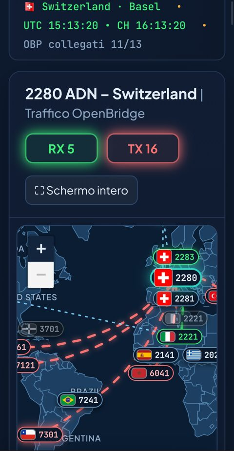
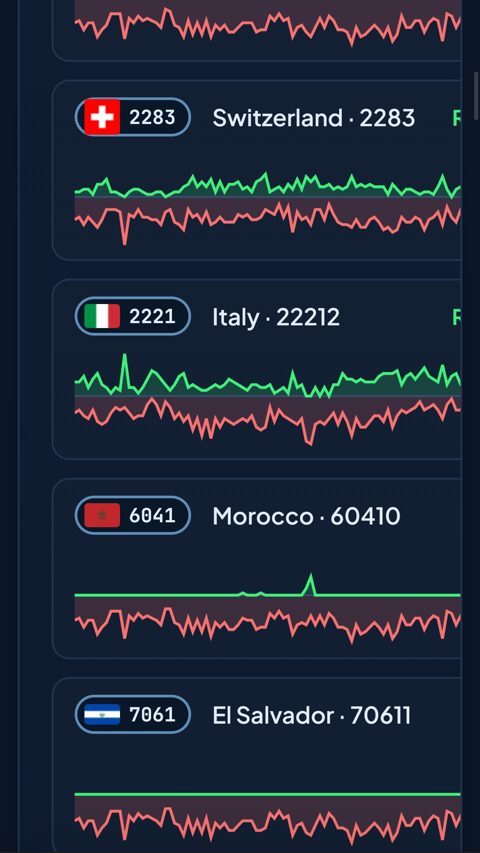
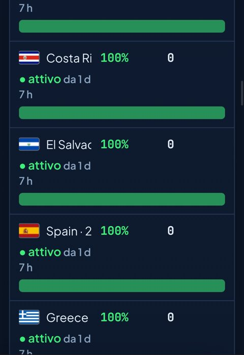
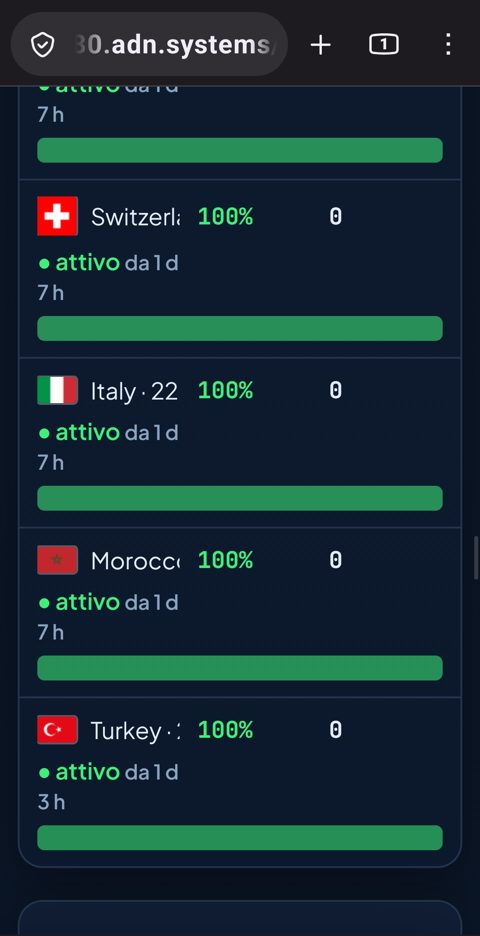
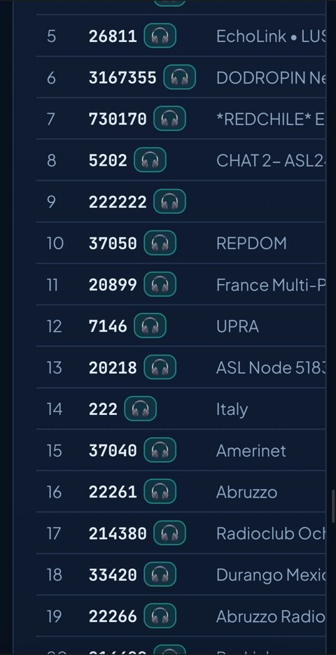
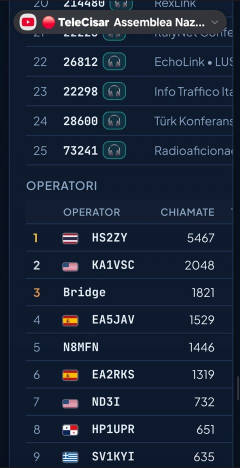

# adn-obpmap

**Live OpenBridge map, statistics and ADN Live page for ADN Systems DMR servers**

🇬🇧 English · [🇮🇹 Italiano](README.it.md)

`adn-obpmap` adds a page at `https://<your-dashboard>/obpmap/` to an **ADN Systems** server (ADN Server v2 + ADN Monitor). It shows where your OpenBridge (OBP) partners are, which traffic comes in and goes out, how reliable each link is, and which talkgroups and operators are the most active.

It runs **beside** ADN Monitor and **does not change it**. The page reads the same live data as the dashboard, from the Monitor's `/ws` websocket. A small recorder written in plain Python, with no extra libraries, stores the history.

It was written from scratch by **Gabriele Biscetti, HB9TVW** for ADN 2280 (Switzerland). The live example is at <https://2280.adn.systems/obpmap/>.

---

## Contents

1. [What you see on the page](#1-what-you-see-on-the-page)
2. [How it works](#2-how-it-works)
3. [Requirements](#3-requirements)
4. [Installation](#4-installation)
5. [Configuration (`config.js`)](#5-configuration-configjs)
6. [Enabling each feature](#6-enabling-each-feature)
7. [Updating and uninstalling](#7-updating-and-uninstalling)
8. [Troubleshooting](#8-troubleshooting)
9. [Files](#9-files)
10. [Credits and license](#10-credits-and-license)

---

## 1. What you see on the page

*Screenshots from ADN 2280 (phone).*

| Live map | OpenBridge Activity | OpenBridge Flows |
|:-:|:-:|:-:|
|  |  |  |

| Link health | Network card | Top talkgroups |
|:-:|:-:|:-:|
|  |  |  |


### 1.1 The live map

| Element | Meaning |
|---|---|
| **Teal pill with a halo** | **Your server** (the hub), with its flag and server number. |
| **Pills above / below the hub** | Your other servers at the same place (option `stacked`), so they do not hide each other. |
| **Pill with a flag and a number** | An **OBP partner**. The number is the partner's ADN server number (the first 4 digits of its OpenBridge `NETWORK_ID`, e.g. `20220` → `2022`). |
| **Green blinking pill + green dashed line** | **RX**: that partner is sending a call **to you** right now. |
| **Red blinking pill + red dashed line** | **TX**: you are sending a call **to that partner** right now. |
| **Grey pill** | The OBP link is **offline** (not connected). |
| **Box next to a pill** (orange border) | The calls on that link right now: direction (RX/TX), callsign, talkgroup and seconds on air. Boxes place themselves so they do not overlap the edges, the other boxes or the pins. |
| **Blue dots** (flag in a blue ring) | The **operator's country**. The first three digits of a DMR ID are the country code (MCC); for example `2284017` → `228` = Switzerland. For every live call a blue dot appears on the operator's country, with a **dotted blue line** to the OBP that brought the call in, or to your server for your local users. **Tap or hover a dot** to see which operators are talking from that country. This shows that a call arriving through Greece may in fact come from an operator in Belgium. |
| **⛶ Fullscreen** | Map in full screen; the map fits itself to the new size. |

On phones the map opens on a view centred on the Atlantic, so that Europe and the Americas are visible together.

### 1.2 OpenBridge Activity

A chart of the traffic for each OBP and for the whole network: **received (RX) above the line, sent (TX) below**.
- Choose **Streams** (number of calls) or **Talk time**.
- Choose the period: **15 min, 1 h, 3 h, 6 h, 12 h or 24 h**.

### 1.3 OpenBridge Flows

A flow diagram. **Left:** where each call came from (an OBP, or "local users" of your server). **Right:** the OBPs your server forwarded it to. The thicker the band, the more traffic. Hover a band to highlight it.

### 1.4 Link health

For every OBP: current status (**up for** / **DOWN since**), **uptime** over **24 h / 7 days / 30 days**, number of **outages**, and a **timeline**.
- **Red** marks an outage. **Grey** is the time before monitoring started.
- A link counts as down only after **2 minutes** without connection, so short drops do not count.

### 1.5 Network card *(optional)*

If you run several ADN servers, their cards appear side by side. Each card shows:
- whether its recorder is alive;
- how many OBPs are up;
- calls and talk time in the last hour, calls and operators in 24 h;
- a chip for every OBP (red = down);
- its top 5 talkgroups;
- a link to its dashboard.

### 1.6 Top talkgroups & operators

Rankings for **1 h, 24 h or 7 days**, by **calls** or **talk time**:
- **talkgroups**, with their names;
- **operators**, with name, flag, QRZ link and the last talkgroup used ("via OBP-xxx" or "local").

The names come from the Monitor's Last Heard.

### 1.7 OpenBridge table and detail panel

The table lists every OBP: country, name, `NETWORK_ID`, status and active calls.

**Click a row, or a pin on the map,** to open the detail panel:
- live status and the calls on air;
- uptime over 24 h and 7 days, outages in 24 h;
- a 24-hour RX/TX activity graph;
- the top talkgroups;
- the last calls, with QRZ links.

On phones the panel slides up from the bottom.

### 1.8 🎧 Listen buttons and the ADN Live page

Next to the talkgroups there is a **🎧** button. It opens **`/obpmap/live/?tg=…`**, and **ADN Live** (`listen.adn.systems/?tg=…`) starts directly on that talkgroup.

`/obpmap/live/` is a page with **your** header (logo, Dashboard, OpenBridge Map, language selector) and ADN Live embedded below it. **↗ App** opens the original ADN Live, where its own app can be installed.

### 1.9 Installable app

Chrome and Edge offer **"Install ADN Systems <your number>"** (menu ⋮ → *Install app*). The app opens full screen on the ADN Live page, with Dashboard and Map in the header.

### 1.10 17 languages

The selector in the header has the same 17 languages as ADN Monitor: EN, ES, PT, FR, DE, IT, NL, CA, BG, ZH, ET, EL, PL, SR, TH, TR and UK. The choice is stored in the **same `language` cookie as the Monitor**, so changing it on the dashboard also changes the map, and the other way round.

### 1.11 Telegram alerts *(optional)*

The recorder can send a Telegram message when an OBP **stays disconnected for more than 2 minutes**, and when it **comes back**, telling how long it was down. Messages are in English or Italian.

---

## 2. How it works

```
 ADN Server ──report──► ADN Monitor ──/ws websocket──┬──► browser: /obpmap/ (live map, live boxes, table)
                                                     │
                                                     └──► obp-recorder (python3, user obprec)
                                                            │ writes every 30 s / 1 min
                                                            ▼
                                     /opt/obpmap/data/history.json  (24 h, activity + flows)
                                     /opt/obpmap/data/stats.json    (7 days, talkgroups / operators)
                                     /opt/obpmap/data/tops.json     (small: rankings, link health)
                                                            │
                                     browser reads them ◄───┘   (+ optional Telegram alerts)

 netfetch.sh (cron, every minute) ──► copies the tops.json of your OTHER servers into data/net/ (network card)
```

- The page connects to `wss://<your-dashboard>/ws`, the same websocket proxy the dashboard uses. **The map must therefore be served by the same Apache site as your dashboard.**
- Without the recorder the live map still works, but Activity, Flows, Link health, rankings and the detail panel stay empty.
- The browser loads Leaflet, topojson, the world borders and the flags from public CDNs (cdnjs, jsDelivr, flagcdn). No data about your users is sent anywhere.

---

## 3. Requirements

- An **ADN Systems** server with **ADN Server v2** and **ADN Monitor** (tested with **2.6.1 and 2.7.0**).
- **Apache 2** serving the Monitor dashboard, with `ProxyPass /ws ws://127.0.0.1:<port>/ws` (the standard Monitor setup).
- **python3** (standard library only) and **curl** (only for the network card).
- *Optional:* `python3-pil` and `fonts-dejavu-core`, to generate the app icons.
- Root access.

---

## 4. Installation

```bash
cd /opt
git clone https://github.com/hb9tvw/adn-obpmap.git adn-obpmap-src
cd adn-obpmap-src
sudo apt install -y python3-pil fonts-dejavu-core   # optional: app icons
sudo ./install.sh
```

*(If you work as root and `sudo` is not installed, simply leave out `sudo` in all commands.)*

The installer asks four questions: your **server number**, the **name** used in titles and alerts, the **Monitor port** (it suggests the one your Apache proxies `/ws` to), and the **language of the alerts** (en/it). It then:
- creates the system user **`obprec`**;
- copies the page to **`/opt/obpmap`**;
- creates `config.js` and the app icons;
- installs and starts the **`obp-recorder`** service and the `netfetch` cron job.

**Then three manual steps.**

**1. Apache.** Add the lines of [`system/apache-obpmap.conf`](system/apache-obpmap.conf) **inside the `<VirtualHost>` of your dashboard** (the HTTPS one, if you use Let's Encrypt). Then:
```bash
sudo apache2ctl configtest && sudo systemctl reload apache2
```

**2. Configuration.** Edit `/opt/obpmap/config.js`: country, city, coordinates, time zone and so on (see the next section).

**3. Open** `https://<your-dashboard>/obpmap/`.

---

## 5. Configuration (`config.js`)

`/opt/obpmap/config.js` holds everything that belongs to **your** server. Updates never overwrite it. Changes are visible after reloading the page; there is nothing to restart.

| Key | Example | Meaning |
|---|---|---|
| `serverId` | `'2280'` | Number on the hub pill and in titles. |
| `serverName` | `'ADN 2280'` | Name in tooltips and flows. |
| `homeNetworkId` | `'22810'` | Optional: the OBP `NETWORK_ID` partners know you by (hub tooltip). |
| `country`, `cc`, `city` | `'Switzerland'`, `'ch'`, `'Basel'` | Header and hub. `cc` is the ISO two-letter code used for the flag. |
| `lat`, `lon` | `47.56, 7.59` | Where the hub pill is drawn. |
| `timeZone`, `tzLabel`, `locale` | `'Europe/Zurich'`, `'CH'`, `'de-CH'` | Time zone and time format for all times on the page. |
| `stacked` | `['2283','22812']` | `NETWORK_ID`s of OBPs to your own servers at the same place, drawn above and below the hub. |
| `locations` | `{'22210': ['it',41.9,12.5,'Italy','left']}` | Position of OBP partners the map does not know, or overrides: code, latitude, longitude, country name, preferred side of the box. Unknown IDs are placed by their country code (first 3 digits). |
| `networkTitle`, `network` | see the example | The network card (section 6.3). An empty list hides it. |
| `adnLiveUrl` | `'https://listen.adn.systems/'` | Page embedded by `/obpmap/live/`. |
| `footer` | `'ADN Systems 2280 · …'` | Footer text. |

---

## 6. Enabling each feature

### 6.1 Live map, table and detail panel
They work as soon as Apache serves `/obpmap` on the dashboard site. Nothing else is needed.

### 6.2 History, rankings and link health (`obp-recorder`)
The installer has already started the recorder. To check it:
```bash
systemctl status obp-recorder
journalctl -u obp-recorder -n 20     # should say: connected to ADN Monitor websocket
ls -l /opt/obpmap/data/              # history.json, stats.json, tops.json updated every minute
```
Its settings are in `/etc/systemd/system/obp-recorder.service`:
- `OBP_SERVER_NAME`: name used in the alerts;
- `OBP_WS_PORT`: the ADN Monitor port;
- `OBP_ALERT_LANG`: `en` or `it`;
- `OBPMAP_DIR`: the installation folder.

After editing the file, run `systemctl daemon-reload && systemctl restart obp-recorder`.

The recorder reconnects by itself when ADN Monitor restarts.

### 6.3 Network card with your other servers
On **each other server**:
1. Install adn-obpmap. Only the recorder is needed there, but the whole installer does no harm.
2. Publish its `tops.json` by adding the optional `Alias /obpdata/tops.json …` lines from `system/apache-obpmap.conf` to its Apache site.

On **the server that shows the card**:
1. In `/opt/obpmap/netfetch.list`, add one line per server: `<id> <url of its tops.json>`. For example:
   ```
   2283 https://2283.adn.systems/obpdata/tops.json
   ```
2. In `config.js`, fill in `network`: one entry per server, including this one with `url: 'data/tops.json'`, and the others with `url: 'data/net/<id>.json'`.

The cron job `/etc/cron.d/obpmap-netfetch` copies the files every minute.

### 6.4 Telegram alerts
1. Create a bot with **@BotFather** and copy its **token**.
2. Send a message to the bot (or add it to a group), then open `https://api.telegram.org/bot<token>/getUpdates` to find the **chat_id**.
3. Create the configuration file:
   ```bash
   sudo mkdir -p /etc/obpmap
   echo '{"token": "123456:ABC...", "chat_id": "-100123456789"}' | sudo tee /etc/obpmap/telegram.json
   sudo chown root:obprec /etc/obpmap/telegram.json && sudo chmod 640 /etc/obpmap/telegram.json
   sudo systemctl restart obp-recorder
   ```

If the file is missing, no alerts are sent.

### 6.5 ADN Live page and 🎧 buttons
They work out of the box at `/obpmap/live/`. To change the embedded page, set `adnLiveUrl` in `config.js`.

### 6.6 Installable app
The installer generates `manifest.webmanifest` and the icons `icon-192.png` / `icon-512.png`, made from the dashboard logo plus your server number.

If the icons are missing:
```bash
sudo apt install python3-pil fonts-dejavu-core
sudo rm -f /opt/obpmap/icon-*.png && sudo ./install.sh --update
```
Chrome then offers *Install app*. It requires HTTPS.

### 6.7 Languages
Nothing to do: the selector appears in the header by itself. To add or fix a translation, edit the dictionary in `web/i18n.js`. `{SRV}` stands for your server number.

### 6.8 Menu entries in the ADN Monitor dashboard
In `adn-monitor.yaml`, add the items to `nav_links`, then restart the Monitor:
```yaml
  nav_links:
    name: "Links"
    items:
      - name: "OBP Map"
        url: "/obpmap/"
      - name: "ADN Live"
        url: "/obpmap/live/"
```
```bash
sudo systemctl restart adn-monitor
```

---

## 7. Updating and uninstalling

**Update.** This keeps `config.js`, `netfetch.list`, the data and the service settings:
```bash
cd /opt/adn-obpmap-src && git pull && sudo ./install.sh --update
```

**Uninstall:**
```bash
sudo systemctl disable --now obp-recorder
sudo rm -f /etc/systemd/system/obp-recorder.service /etc/cron.d/obpmap-netfetch
sudo rm -rf /opt/obpmap /etc/obpmap
sudo userdel obprec
```
Then remove the `/obpmap` lines from the Apache site and reload Apache.

---

## 8. Troubleshooting

| Symptom | Check |
|---|---|
| "reconnecting…" and an empty map | `/ws` must reach ADN Monitor. The map has to be on the **same Apache site** as the dashboard, and the dashboard itself must show live data. |
| Map OK, but Activity, Flows, Health and rankings stay "loading" | `journalctl -u obp-recorder`: check that the port is right (`OBP_WS_PORT`) and that `/opt/obpmap/data/*.json` is updated every minute and readable by Apache. |
| An OBP has no pin | Its `NETWORK_ID` is not known: add it to `locations` in `config.js`. |
| Wrong times | `timeZone` and `locale` in `config.js`. |
| Network card shows "no data" | `sudo -u obprec /opt/obpmap/netfetch.sh`, then `ls /opt/obpmap/data/net/`. Check that the URLs in `netfetch.list` open in a browser. |
| No Telegram alerts | `/etc/obpmap/telegram.json` must be readable by the group `obprec`; look for "telegram error" in `journalctl -u obp-recorder`. |
| No "Install app" | It needs HTTPS and the icons (section 6.6). The green "Install" button **inside** ADN Live installs the ADN Live app, not yours. Use the browser menu instead. |
| Old page after an update | Reload with Ctrl+F5, or close and reopen the tab on the phone. |

---

## 9. Files

```
web/                      → copied to /opt/obpmap
  index.html              the map page
  config.example.js       template of config.js (your settings)
  common.js               applies config.js to the page
  origin.js               blue operator-country dots
  health.js               Link health
  tops.js                 Top talkgroups & operators
  details.js              OBP detail panel
  network.js              network card
  listen.js               🎧 buttons
  i18n.js                 17 languages
  live/index.html         ADN Live page
  manifest.template.webmanifest, sw.js   installable app
recorder/
  recorder.py             obp-recorder (python3, standard library only)
  netfetch.sh             copies tops.json of your other servers
  netfetch.example.list   template of netfetch.list
system/
  obp-recorder.service    systemd unit
  obpmap-netfetch.cron    cron job
  apache-obpmap.conf      lines to add to Apache
tools/make_icons.py       creates the app icons
install.sh                installer / updater
```

---

## 10. Credits and license

- Written by **Gabriele Biscetti, HB9TVW**, president of the Funk-Amateur-Club Basel **HB9CSR**, for the ADN Systems network.
- The idea of an OpenBridge map comes from the map of Antonios **SV0XAL**, ADN 2022 Greece. This code was written independently and from scratch.
- **ADN Monitor**, the dashboard this map runs beside, is entirely the work of **Adán**: many thanks.
- Thanks to **Rodrigo Pérez** for the `?tg=` link in ADN Live, used by the 🎧 buttons, and to the whole **ADN Systems** team.
- Map data © **Natural Earth** (world-atlas), map library **Leaflet**, flags **flagcdn.com**.

Released under the [MIT License](LICENSE). 73!
